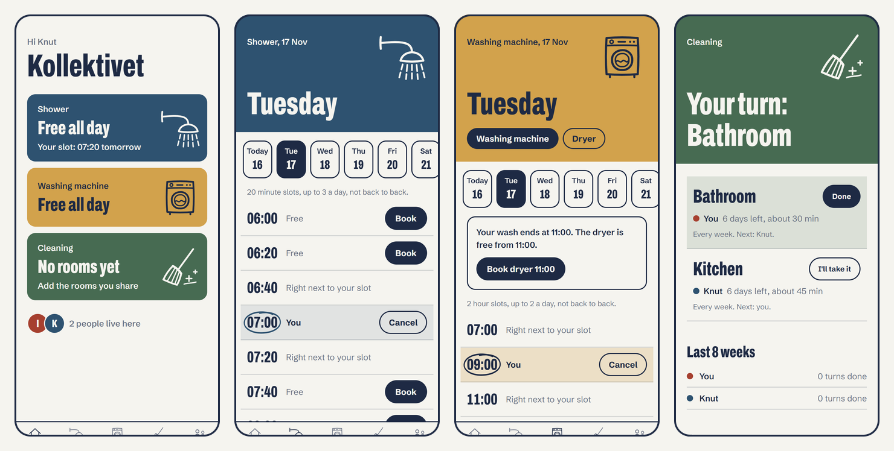

<p align="center">
  
</p>

# Kubbe

Take back your shower time, your slot with the washing machine, and make your roommates clean up the common areas.

Kubbe is a small web app for people who share a home. You book the shower and the laundry in time slots, and a cleaning rota goes round by itself. It is built for phones, and it can be added to the home screen like an app.

**Live:** https://kubbe-zeta.vercel.app



## What it does

**Households.** You create an account, then start a household or join one. Whoever starts it is the admin and gets a six-character code and an invite link to share. Everything happens inside one household, and nothing is shared between households.

**Shower.** The day is cut into slots. You tap Book, and your time gets circled like on a paper sign-up sheet. You see who has which slot, and the headline tells you who is in there now or how long it is free.

**Laundry.** The washing machine and the dryer are booked the same way. The dryer is optional, since not every home has one. When you book a wash, Kubbe offers you the dryer slot that follows it.

**Fair by rule, not by argument.** The admin sets, for each of shower, washer and dryer:

- how long a slot is, and between which hours it can be booked
- how many slots one person may take in a day
- whether two slots in a row are allowed (off by default, so nobody camps in the bathroom)
- how many days ahead you can book

The server enforces all of it. If two people press Book on the same slot at the same moment, exactly one gets it and the other is told who did.

**Cleaning.** The admin adds rooms or chores, how often each is due and roughly how long it takes. Turns rotate between roommates in the order they joined, and each room starts one person further along so nobody gets everything in the same week. You mark your turn done, take over someone else's, or hand one back. A tally shows who has done how many turns in the last eight weeks.

**Home.** One screen says what matters right now: whether the shower is free, when your next slot is, and whether it is your turn to clean.

**Household.** Admins rename the household, replace the join code, make others admin and remove people who moved out. Everyone can change their name and colour, or leave. A household always keeps at least one admin.

## How it is built

| Part | Choice |
|---|---|
| Framework | [Next.js 16](https://nextjs.org) (App Router), TypeScript, React 19 |
| Styling | Tailwind CSS 4, plain CSS for the drawing animations |
| Database | [Neon](https://neon.tech) Postgres, through the Vercel integration |
| Data access | [Drizzle ORM](https://orm.drizzle.team), SQL migrations in `drizzle/` |
| Accounts | [Better Auth](https://better-auth.com), email and password |
| Validation | Zod |
| Tests | Vitest (rules and rota), Playwright (whole flows in a phone-sized browser) |
| Hosting | Vercel |

A few decisions worth knowing about:

- **Slots and cleaning turns are never stored.** They are worked out from each room's settings. Only what people do is stored: a booking, a turn marked done, a turn taken over. Changing a rule never leaves stale rows behind.
- **The database has the last word on double booking.** A Postgres exclusion constraint refuses two overlapping bookings of the same resource, whatever the application does.
- **Rules are plain functions.** `src/lib/booking/rules.ts` and `src/lib/cleaning/rota.ts` have no database or framework in them, which is what makes them easy to test, including on the days the clocks change.
- **The household comes from the session.** Every screen and action starts with `requireHousehold()`. Ids sent by the browser are looked up inside that household, so an id from another household finds nothing.
- **Times are stored in UTC and shown in the household's time zone.**

### Where things are

```
src/
  app/
    (auth)/          sign in, sign up
    onboarding/      create or join a household
    join/[code]/     the invite link
    (app)/           signed-in screens, with the tab bar
      home/          dashboard
      shower/        booking
      laundry/       booking, washer and dryer
      cleaning/      rota
      settings/      the Household screen
  components/
    booking/         the booking screen and slot list shared by shower and laundry
    illustrations/   the room drawings
    logo/            the logo component and its generated data
    ui/              form controls and buttons
  db/                schema and connection
  lib/
    booking/         rules, service, server actions
    cleaning/        rota, service
    session.ts       who is asking, and which household they are in
design/logo/         the logo generator: the single source of the logo and app icons
drizzle/             SQL migrations
e2e/                 browser tests
```

## Running it yourself

You need Node.js 24 and a Postgres database. The easiest route is the one this project uses: a Vercel project with the Neon integration.

```bash
git clone https://github.com/alexander-b-morland/kubbe.git
cd kubbe
npm install
```

Create the environment files. `.env.example` lists what is needed.

```bash
npx vercel link
npx vercel env pull .env.local
```

Then put a secret for signing sessions in `.env.development.local` (this file is not overwritten when you pull again):

```bash
node -e "console.log('BETTER_AUTH_SECRET=' + require('crypto').randomBytes(32).toString('base64url') + '\nBETTER_AUTH_URL=http://localhost:3000')" > .env.development.local
```

Create the tables and start the app:

```bash
npm run db:migrate
npm run dev
```

Open http://localhost:3000.

### Commands

| Command | What it does |
|---|---|
| `npm run dev` | Start the app locally |
| `npm run build` | Build for production |
| `npm run lint` | Check code style |
| `npm run typecheck` | Check types |
| `npm test` | Unit tests for the booking rules, rota and helpers |
| `npm run test:e2e` | Browser tests of whole flows, at phone size |
| `npm run db:generate` | Write a migration after changing `src/db/schema.ts` |
| `npm run db:migrate` | Apply migrations |
| `npm run db:studio` | Browse the database |
| `node design/logo/generate.mjs --icons` | Rebuild the logo files and app icons |

The browser tests use the Edge that ships with Windows. They create accounts ending in `@kubbe.test` and delete them when they finish. They run against whichever database `.env.local` points at, so give local work its own Neon branch before real people depend on the data.

### Deploying

Push to `main` and Vercel builds it. The production environment needs `DATABASE_URL` (set by the Neon integration) and `BETTER_AUTH_SECRET`. Run `npm run db:migrate` against the production database after a migration is added.

## Design

The look is deliberate, and recorded in [CLAUDE.md](CLAUDE.md):

- **Colour means room.** Fjord blue is the shower, ochre is laundry, spruce green is cleaning. The colours are muted and taken from Norwegian house paint.
- **Drawing is the signature.** The logo, the room illustrations, the circle around a booked time and the line through a finished chore are all pen strokes that draw themselves. People who prefer reduced motion see the finished drawing instead.
- **The logo** is the mascot of the flat this app was first made for: a carved wooden hand holding a trout. It is generated from `design/logo/generate.mjs`.
- **Type.** Times and headlines are set in Archivo, condensed and heavy. Everything else is Schibsted Grotesk.

## Not done yet

- **Google sign-in.** Needs credentials from a Google Cloud project.
- **Password reset and verified email addresses.** Both need the app to send email, which needs a domain.
- **Reminders.** For example "your wash is done" or "your shower slot starts in ten minutes".
- **Repeating bookings.** For example the same shower slot every weekday.
- **A separate database for local work and tests.**
- **Norwegian.** The interface is in English, with the text kept close to the screens so it can be translated.
- **Add-ons a household can switch on:** a shared shopping list, and dinner suggestions that roommates vote on, which then produce a shopping list and say who is responsible.

## Background

Kubbe started as a house website that two friends built for their shared flat in Trondheim. This version is a new app written from scratch, for any shared home.

## License

[MIT](LICENSE)
